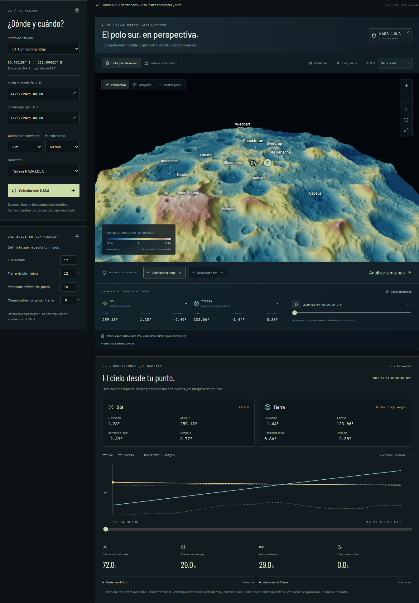

# LUNAR ORACLE · Lunar Landing Site Navigator

Planifica una misión al polo sur lunar con **topografía NASA LOLA y efemérides NASA/JPL Horizons**. El inicio muestra el mapa 3D, compara dos puntos y fechas, y reproduce un descenso vertical calculado con física.

## Empezar

    git clone https://github.com/GabrielChambi/NASA_MISION_ARTEMISA.git
    cd NASA_MISION_ARTEMISA
    npm.cmd --prefix frontend ci
    python -m venv api/.venv
    api/.venv/Scripts/python.exe -m pip install -r api/requirements.txt
    npm.cmd run dev:full

**Web:** http://127.0.0.1:5173/ · **API:** http://127.0.0.1:8000/docs

Requisitos: Node 22.12+ (probado con 24.14), Python 3.11, Git. Las pruebas de navegador usan Google Chrome y Playwright. En Linux/macOS usar npm, python3 y api/.venv/bin/python. El lanzador inicia ambos servicios; cerrarlo detiene los procesos.

Se entra directamente al planificador, sin cuenta ChatGPT ni clave NASA. El [sitio público existente](https://lunar-oracle-mission-control.gptcompartir.chatgpt.site) conserva su último despliegue; **esta revisión está en GitHub y localmente, pendiente de publicación**. El conector Sites devuelve “Sites project not found” al solicitar escritura al proyecto existente. No se creó otro sitio ni se modificó su audiencia.

## Usar el sistema

1. Elige Connecting ridge / Site01 o Shackleton rim / Site04 en el mapa o selector.
2. Define fechas **UTC**, altura, muestreo y horizonte. Pulsa **Calcular con NASA**; ambos puntos usan condiciones idénticas.
3. Desliza el tiempo: mapa, posiciones del Sol y la Tierra, horizonte y despeje muestran la misma muestra NASA.
4. Ajusta luz mínima, Tierra visible mínima, pendiente máxima y margen terrestre. Las ventanas y razones se recalculan desde las series alineadas.
5. Pulsa **Simular descenso**. La nave se mueve sobre las coordenadas del punto; altura, velocidad, masa, propelente y empuje salen de la integración física. Puedes pausar, acelerar o recorrer el tiempo.
6. Al tocar el terreno, el mapa centra y marca el contacto. Empuje o combustible insuficientes producen **impacto**, no éxito.
7. **Descargar evidencia** guarda fechas, criterios, muestras, procedencia, comparación y la integración en JSON. **Datos y método** abre los módulos avanzados y su exportación CSV.

Los pasos superiores son accesos directos. En móvil el mapa aparece primero. Fechas, altura, horizonte, muestreo, retraso y criterios son compartidos con los módulos avanzados de main.

## Qué es medido y qué es modelado

| Parte | Procedencia / alcance |
| --- | --- |
| Relieve 3D | NASA LOLA regional, fuente 80 m; malla de ~791 m y curvatura lunar |
| Puntos y pendiente | Píxeles centrales de GeoTIFF NASA de 5 m; no lugares aprobados de aterrizaje |
| Sol y Tierra | API NASA/JPL Horizons, observador lunar coord@301, respuesta y consulta trazables |
| Horizonte | Perfil LOLA por azimut y altura 1/2/5 m; búsqueda finita, **cobertura parcial** |
| Ventanas | Centro del astro sobre horizonte; margen para Tierra; intervalos semiabiertos |
| Comparación | Criterios del usuario, intersección, luz y Tierra; empates explícitos |
| Descenso | Gravedad central JPL, empuje limitado, masa e Isp; **nave hipotética editable** |
| Nave en mapa | Posición calculada sobre coordenadas fijas; símbolo ampliado sin escala física |

La fecha inicial **14–17 diciembre 2026**, altura **2 m**, paso **60 min**, dispone de respuestas NASA originales incluidas. También el escenario +12 h. Otras consultas requieren conexión JPL o una entrada exacta en caché. Si falla NASA o falta horizonte, se informa sin sustituir cifras.

Ejemplo con horizonte LOLA parcial: Site01 ofrece **72 h de Sol, 29 h de Tierra, 29 h simultáneas**, pendiente **3,80°**; Site04 ofrece **72 h de Sol y 0 h de Tierra**, pendiente **32,74°**. Son resultados para estos píxeles, fechas y altura; no una recomendación certificada.

El descenso integra las ecuaciones de movimiento y consumo con RK4 cada 0,1 s. Sus parámetros de nave son de ejemplo, no especificaciones Artemis. No calcula la trayectoria orbital Tierra–Luna, estabilidad de patas, energía eléctrica ni presupuesto de radio. [Método y pruebas](docs/science/mission_planner.md).

## Verificar

    npm.cmd run build:hosted
    api/.venv/Scripts/python.exe -m pytest api/tests -q
    npm.cmd run test:science

    # Producción local con API integrada, sin Python
    npm.cmd --prefix frontend run preview:hosted

    # Otra terminal, URL predeterminada 4173
    node frontend/scripts/verify-planner.mjs

La compilación Worker incluye frontend y API con los mismos registros NASA. El comando preview sin “hosted” sirve sólo frontend y necesita Python. Para verificar los módulos avanzados:

    $env:LUNAR_ORACLE_TEST_URL='http://127.0.0.1:4173/'
    node frontend/scripts/verify-atlas.mjs
    node frontend/scripts/verify-science.mjs
    node frontend/scripts/verify-main-integration.mjs

**45 pruebas Python y 30 Node.** Se contrastan coordenadas, UTC, muestras, rango medido, ventanas, fallos, altura y física. La caída libre se compara con conservación de energía; el consumo con la integral de empuje; el contacto con reducción del paso. El navegador comprueba fechas, criterios, contacto/impacto, evidencia JSON, fallos sin resultados obsoletos y tamaños 360/390/768/1500 px. Las capturas locales quedan en artifacts/, fuera de Git.

## Datos y reproducibilidad

    # Siete productos NASA y perfiles
    api/.venv/Scripts/python.exe api/scripts/acquire_nasa.py
    # Respuestas originales y seis consultas de contraste JPL
    api/.venv/Scripts/python.exe api/scripts/prepare_ephemeris.py
    # Atlas con nombres IAU/USGS
    api/.venv/Scripts/python.exe api/scripts/prepare_polar_atlas.py
    # 14–17 diciembre y escenario +12 h
    api/.venv/Scripts/python.exe api/scripts/prepare_hosted_mission.py

Los originales grandes, varios cientos de MB, quedan en data/raw/, fuera de Git. Se versionan catálogos, SHA-256, derivados, horizontes y respuestas JPL. El atlas verifica su binario al cargar. Las cachés emparejan todos los parámetros; el antiguo archivo semilla de B ya no alimenta las rutas activas.

Fuentes: [NASA LOLA / PGDA](https://pgda.gsfc.nasa.gov/products/78), [DEM regional](https://pgda.gsfc.nasa.gov/data/LOLA_20mpp/LDEM_80S_80MPP_ADJ.TIF), [Horizons API](https://ssd-api.jpl.nasa.gov/doc/horizons.html), [nomenclatura USGS](https://planetarynames.wr.usgs.gov/GIS_Downloads), [gravedad JPL](https://ssd.jpl.nasa.gov/astro_par.html), [propulsión NASA Glenn](https://www1.grc.nasa.gov/beginners-guide-to-aeronautics/specific-impulse/).

## Dónde continuar

    frontend/src/App.tsx                          Montaje con contexto
    frontend/src/features/mission/MissionPlanner.tsx  Flujo principal
    frontend/src/features/mission/missionAnalysis.ts Ventanas y criterios
    frontend/src/features/mission/descentPhysics.ts  Física determinista
    frontend/src/features/mission/MissionContext.tsx Misión compartida
    frontend/src/features/sites/PolarTerrainAtlas.tsx Atlas y contacto
    frontend/src/features/earth/                 Observatorio avanzado
    frontend/worker/science.mjs                  API GET publicada
    frontend/worker/mission.mjs                  Compatibilidad POST
    api/app/solar/                              Servicio NASA común
    api/app/mission_bridge.py                   Compatibilidad Python
    data/catalog/                              Sitios e inventario
    data/prepared/                             Derivados y registros NASA
    docs/science/                              Métodos y evidencias

Mantener los campos compartidos siteIds, startUtc, endUtc, stepMinutes, horizonMode, delayHours y observerHeightM al integrar funciones. Los criterios y la procedencia deben seguir explícitos.

Rutas GET: /api/sites, /api/solar, /api/earth, /api/horizon, /api/sites/{id}/terrain, /api/terrain, /api/datasets, /api/methodology y /api/health. POST /api/earth y /api/compare conservan el contrato de main con el servicio común. GET Earth devuelve el contrato común; include_range=true solicita rango y velocidad radial medidos.

## Límites y pendientes

Los perfiles y el mapa son finitos y muestreados; no detectan todos los obstáculos ni propagan incertidumbre probabilística. Falta contraste independiente SPICE. Las transiciones de visibilidad no son exactas entre muestras. Seleccionar coordenadas arbitrarias exige reprocesar elevación y horizonte; ahora se admiten los dos píxeles conocidos.

La simulación vertical no certifica seguridad ni sustituye software de vuelo. La secuencia cinematográfica anterior permanece en LaunchScene3D.tsx como código histórico, fuera del inicio. El [plan original](docs/DEVELOPMENT_PLAN.md) es contexto; el [estado verificado](docs/IMPLEMENTATION_STATUS.md) describe la implementación. Se usó IA para programación; fuentes y dependencias conservan sus condiciones. Definir licencia del proyecto antes de presentarlo como código abierto.
