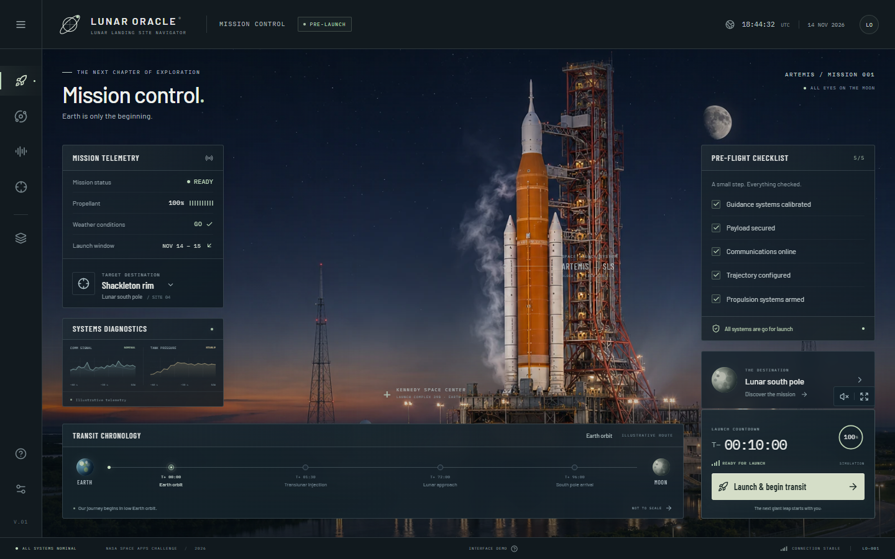

# LUNAR ORACLE · NASA Misión Artemisa

**Repositorio de desarrollo de Lunar Landing Site Navigator.** El objetivo completo es explorar y comparar regiones candidatas de aterrizaje en el polo sur lunar mediante geometría del Sol y la Tierra, terreno y escenarios de misión.

La entrega actual es solamente la pantalla inicial **Mission Control**. El motor científico y las otras pantallas están pendientes. Leer [el contexto y plan de desarrollo](docs/DEVELOPMENT_PLAN.md) antes de continuar.



[Abrir la demostración privada](https://lunar-oracle-mission-control.gptcompartir.chatgpt.site). Este enlace requiere acceso del propietario; todavía no es la entrega pública de la competencia.

Pantalla de inicio de **Lunar Landing Site Navigator**, inspirada en la referencia visual proporcionada. Interfaz en inglés, construida con React, TypeScript y Vite.

## Ejecutar en Windows

Requisitos: Git y Node.js 22.12 o posterior con npm. Se comprobó con Node.js 24.14. En un equipo nuevo:

```powershell
git clone https://github.com/GabrielChambi/NASA_MISION_ARTEMISA.git
cd NASA_MISION_ARTEMISA
```

Desde la raíz del proyecto:

```powershell
npm.cmd --prefix frontend ci
npm.cmd run dev
```

Abrir la dirección local que imprime Vite, normalmente `http://127.0.0.1:5173`.

Se usa `npm.cmd` en Windows para evitar restricciones de ejecución de `npm.ps1`. En Linux/macOS usar `npm`. Esta entrega no necesita claves API, variables de entorno, Python ni una base de datos.

```powershell
npm.cmd run build
npm.cmd run preview
```

## Alcance de esta entrega

- Únicamente la pantalla de inicio / Mission Control.
- Fondo cinematográfico local optimizado en WebP, generado con IA.
- Diseño adaptable a escritorio, tablet y móvil.
- Selección entre Shackleton rim y Connecting ridge.
- Checklist interactivo: se requieren las cinco verificaciones para habilitar el lanzamiento.
- Cuenta regresiva de demostración de 10 segundos, con cancelación y reinicio.
- Cronología interactiva, reloj UTC, sonido opcional, pantalla completa y ajustes de animación.
- Diálogos accesibles con instrucciones, destino y explicación de la telemetría.

La telemetría, disponibilidad, clima, carga de combustible y los tiempos de tránsito son **ilustrativos** y se identifican como demostración en la interfaz. No se ha implementado un backend ni se muestran resultados de JPL Horizons o LOLA. La imagen de lanzamiento es una ilustración generada con IA, no una fotografía oficial de NASA.

El documento maestro se utilizó como contexto del producto; sus módulos científicos y demás pantallas quedan fuera de esta primera entrega.

## Estructura

```text
frontend/
  public/images/artemis-launchpad.webp
  src/App.tsx       # Pantalla y sus interacciones
  src/styles.css    # Diseño y adaptación a pantallas
  src/main.tsx
```

La raíz contiene comandos que delegan al frontend. `frontend/package-lock.json` permite instalaciones reproducibles. `frontend/.openai/hosting.json` conserva la identidad del despliegue en Sites y no contiene credenciales. `docs/` contiene contexto, plan y capturas. Todavía no existen backend ni datos científicos preparados.

## Validación

```powershell
# Desde la raíz: comprueba TypeScript y genera frontend/dist
npm.cmd run build

# Con Vite ejecutándose en 127.0.0.1:5173, en otra terminal:
cd frontend
node scripts/verify-home.mjs
```

La comprobación usa Playwright con Google Chrome instalado (`channel: chrome`). Cubre cinco tamaños (1440, 1280, 768, 390 y 360 px), desbordamientos, solapamientos, checklist, destino, diálogos/Escape, cronología, ajustes, lanzamiento, cancelación, final de cuenta regresiva, reinicio y navegación móvil. Genera capturas en `artifacts/`, excluida de Git.

## Continuar el sistema

El siguiente incremento recomendado es una sección de extremo a extremo: **dos sitios verificados + intervalo UTC + consulta real a Horizons + gráfico con procedencia**. Después implementar comparación, horizonte y escenarios. No convertir los valores decorativos actuales en resultados científicos.

Stack actual: React 19, TypeScript, Vite, lucide-react, CSS y tipografías locales Fontsource. Stack propuesto: FastAPI, httpx y NumPy; añadir Rasterio al procesar terreno y una biblioteca de gráficas cuando se conecten series reales. Dependencias y backend propuestos aún no están implementados.

## Fuentes previstas

- [JPL Horizons API](https://ssd-api.jpl.nasa.gov/doc/horizons.html) y [manual](https://ssd.jpl.nasa.gov/horizons/manual.html): observador lunar y efemérides Sol/Tierra.
- [Regiones de aterrizaje LOLA](https://pgda.gsfc.nasa.gov/products/78) y [datos de 5 m/píxel](https://pgda.gsfc.nasa.gov/data/LOLA_5mpp/): terreno y definición fundamentada de sitios.
- [NAIF / SPICE](https://naif.jpl.nasa.gov/naif/): marcos de referencia y validación futura.

Son fuentes para la implementación pendiente; todavía no se han conectado ni validado resultados. Verificar coordenadas, marcos y convenciones antes de mostrar cálculos.

## Colaboración y entrega

- Trabajar por ramas y mantener `main` ejecutable.
- Acordar esquemas JSON antes de integrar frontend y backend.
- Mantener visibles UTC, unidades, fuentes, supuestos y resolución temporal.
- No subir credenciales, `.env`, dependencias instaladas, compilaciones ni mosaicos de terreno gigantes.
- Antes de entregar, configurar acceso público explícitamente, probar en incógnito y verificar requisitos y plazos en la plataforma oficial.

Se utilizó IA para asistencia de desarrollo y generación del fondo principal. El equipo debe elegir una licencia antes de presentar el repositorio como software de código abierto; las dependencias conservan sus licencias correspondientes.
