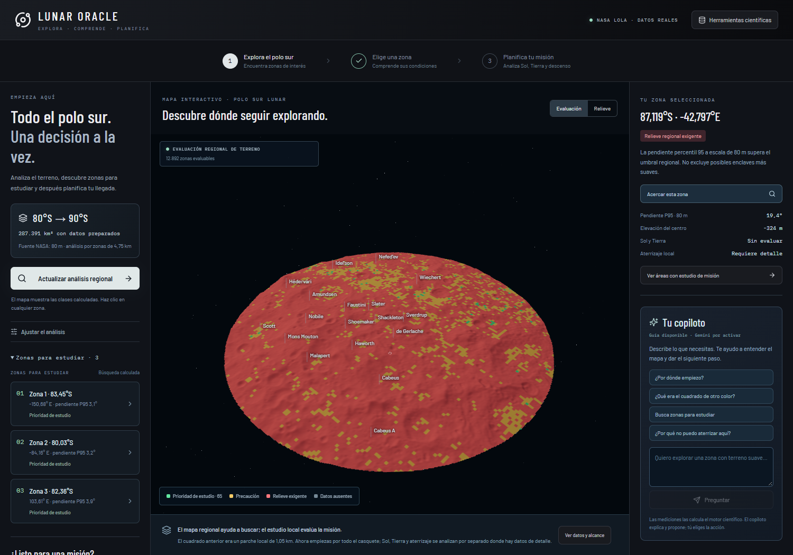

# LUNAR ORACLE · Lunar Landing Site Navigator

Explora **todo el casquete lunar de 80°S a 90°S**, compara zonas con terreno NASA y pasa al estudio de misión local. Incluye copiloto preparado para **Gemini**, efemérides JPL y descenso físico. Entrada directa, sin cuenta ChatGPT ni Google para los visitantes.

## Ejecutar

En Windows, desde la raíz del repositorio:

~~~powershell
npm.cmd --prefix frontend ci
python -m venv api/.venv
api/.venv/Scripts/python.exe -m pip install -r api/requirements.txt
npm.cmd run dev:full
~~~

Web: http://127.0.0.1:5173/ · API y documentación: http://127.0.0.1:8000/docs

Node 22.12+ y Python 3.11+. En Linux/macOS, usar npm, python3 y api/.venv/bin/python. El lanzador inicia los dos servicios y los detiene al cerrarse. Los derivados NASA y las consultas originales del caso inicial están incluidos; los grandes TIFF se descargan sólo para regenerar o auditar los derivados.

## Explorar, elegir y planificar

1. **Explora el polo sur:** abre el mapa completo y pulsa **Analizar todo el polo sur**. Se clasifican 12.892 zonas a partir del DEM NASA de 80 m, sin extender el horizonte de un punto a toda la Luna.
2. **Elige una zona:** toca la Luna o una de las tres propuestas del buscador calculado. Consulta pendiente regional, elevación, datos pendientes y usa **Acercar esta zona**.
3. **Planifica tu misión:** **Abrir estudio detallado** lleva a las dos áreas que ya cuentan con DEM local de 5 m y perfiles de horizonte. Elige una, fechas UTC y pulsa **Analizar Sol y Tierra**. Las opciones técnicas están plegadas.
4. Recorre el tiempo y, si hay resultados válidos, ensaya el descenso y descarga evidencia. Al cambiar parámetros se invalidan los resultados anteriores.
5. Pregunta al copiloto cómo empezar, por qué falla un destino o qué hacer después. Las acciones propuestas requieren un clic y las cifras se muestran desde los datos estructurados.

**El antiguo cuadrado** era una rejilla local de 1,05 × 1,05 km. Ahora la pantalla inicial muestra todo el polo y esa rejilla sólo aparece al abrir el estudio detallado. No se ha pintado de verde una extensión sin analizar.

### Qué significan los colores

| Vista | Verde / amarillo / rojo |
| --- | --- |
| Polo sur regional | Prioridad de estudio / precaución / relieve exigente, según pendientes derivadas del DEM de 80 m |
| Estudio local | Cumple criterios del modelo / margen limitado / incumple pendiente, relieve o condiciones Sol–Tierra |

Gris conserva datos ausentes. Una zona regional roja puede contener enclaves suaves menores; una zona verde **todavía necesita** estudiar huella, obstáculos, Sol y Tierra. El cribado regional no certifica aterrizajes.

El casquete tiene unas 288.139 km². Las celdas de 4,75 km cubren aproximadamente 287.391 km² (99,74%); el borde finito y nodata no se declaran evaluados. Se calculan pendientes en los píxeles originales de 80 m, corrigiendo la escala de la proyección, y se agregan por zona; no se derivan del atlas visual de ~791 m.

### Activar Gemini

La integración está implementada en las APIs Python y Worker. Hace falta una clave propia para probar inferencia real:

~~~powershell
if (-not (Test-Path .env)) { Copy-Item .env.example .env }
# Edita .env: GEMINI_API_KEY=tu_clave
npm.cmd run dev:full
~~~

Si ya tienes .env, edítalo sin reemplazarlo. Crear la clave: [Google AI Studio](https://aistudio.google.com/apikey). El proveedor se configura con AI_PROVIDER=gemini y el modelo mediante AI_MODEL; el ejemplo usa gemini-3.5-flash-lite, configurable según disponibilidad de tu proyecto. Tras editar la clave, reinicia el servidor. El lanzador también lee .env para la API alojada en la vista previa local.

La clave sólo la usa el servidor: no aparece en variables VITE_, HTML, URLs de consulta ni Git. En un despliegue remoto hay que configurar la misma clave como secreto del servidor, no subir .env.

Sin clave o ante una caída, el componente dice **Guía del sistema · sin modelo IA**. No se presenta el buscador determinista como IA. El copiloto explica los datos de la vista actual y propone acciones limitadas; no cambia ecuaciones, restricciones, coordenadas ni ejecuta cálculos por su cuenta. Las respuestas generadas que contienen cifras no verificadas, garantías o destinos no autorizados se descartan. Los tests de inferencia usan respuestas simuladas del proveedor; no sustituyen una comprobación real con una clave válida.

**Herramientas científicas** abre los módulos anteriores. El caso local se conserva al ir y volver. El intervalo local de ejemplo es 14–17 de diciembre de 2026, altura 2 m, cadencia 60 minutos y respuestas JPL originales incluidas; otras celdas/fechas necesitan conexión o caché exacta.

## Datos y cálculo

| Parte | Fuente y alcance |
| --- | --- |
| Elevación, pendiente y error de altura | GeoTIFF originales NASA LOLA/PGDA [producto 78](https://pgda.gsfc.nasa.gov/products/78), espaciado de 5 m |
| Exploración regional | 12.892 zonas del casquete 80–90°S; DEM original de 80 m y agregación de 4,75 km |\n| Cobertura de aptitud local | Dos áreas de 1,05 × 1,05 km; 441 celdas por área; el resto no tiene evaluación local preparada |
| Huella | Radio fijo de 15 m; el máximo de pendiente considera todos los píxeles de 5 m de cada celda más ese margen |
| Relieve | Rango de alturas en un cuadrado central de 35 × 35 m |
| Horizonte | 360 azimuts, esfera lunar sin exageración, norte/este local verdadero; rayos locales cada 10 m y regionales cada 250 m, hasta 250 km |
| Coherencia científica | Misma convención de horizonte que el motor anterior; pruebas comparan ambos en los píxeles de referencia |
| Sol y Tierra | [NASA/JPL Horizons](https://ssd-api.jpl.nasa.gov/doc/horizons.html), observador coord@301; azimut, elevación aparente sin refracción y distancia |
| Celdas vecinas | Traslación geométrica del vector aparente NASA con su distancia y conversión al ENU local; aproximación espacial declarada |
| Ventanas | Intervalos [inicio, fin); la muestra final no añade duración; incertidumbre temporal hasta una muestra |
| Nave | Hipótesis de ejemplo; RK4 con paso de 0,1 s, gravedad central JPL, caudal por Isp y límite de empuje |
| Vista 3D | Parche local de 5 m, contexto local de 75 m y contexto polar reducido; alturas sin exageración en el cockpit |

El contorno responde a pendiente, relieve, visibilidad instantánea y horas requeridas en todo el intervalo. La reserva amarilla de 0,5° angular y 1° de pendiente es una elección de cribado, **no una cota estadística de error**.

NASA indica que cerca del 90% de los píxeles de estos DEM de 5 m son interpolados: espaciado no equivale a resolución efectiva independiente. Se muestra el error de altura, pero aún no se propagan todas las incertidumbres. Los objetos menores de 5 m no quedan resueltos.

Es un **prototipo de gemelo de planificación**, con cobertura y modelos acotados. No es un sistema de navegación certificado. No calcula balance térmico, energía eléctrica, presupuesto de enlace RF, guiado lateral, estabilidad de patas ni trayectoria orbital Tierra–Luna. La validación independiente de marcos con SPICE sigue pendiente. Un contacto suave del vehículo hipotético no convierte una celda roja en apta.

## Verificar

~~~powershell
npm.cmd run build:hosted
api/.venv/Scripts/python.exe -m pytest api/tests -q
npm.cmd run test:science

# Servidor de producción local: frontend + API, sin Python
npm.cmd --prefix frontend run preview:hosted

# En otra terminal, con Google Chrome instalado
node frontend/scripts/verify-experience.mjs
node frontend/scripts/verify-landing.mjs
node frontend/scripts/verify-planner.mjs
node frontend/scripts/verify-main-integration.mjs
~~~

Los tests científicos incluyen casos NASA almacenados, igualdad de perfiles entre motores, muestreo de TIFF nativos, curvatura, nodata, fechas inválidas, ventanas y dinámica física. El test de navegador cubre contornos, exportación, contacto, cambio de vistas, móvil y fallos de dependencias. Usa LUNAR_ORACLE_TEST_URL para cambiar la URL por defecto 4173.

## Regenerar los derivados NASA

~~~powershell
api/.venv/Scripts/python.exe api/scripts/acquire_nasa.py
api/.venv/Scripts/python.exe api/scripts/prepare_polar_atlas.py
api/.venv/Scripts/python.exe api/scripts/prepare_polar_screening.py
api/.venv/Scripts/python.exe api/scripts/prepare_landing_surface.py
api/.venv/Scripts/python.exe api/scripts/prepare_landing_ephemeris.py
~~~

Los TIFF originales se guardan en data/raw, ignorado por Git. landing_surface.json conserva los SHA-256 de las siete fuentes originales, criterios de muestreo y limitaciones. Las consultas preparadas conservan parámetros completos, URL, fecha de recuperación y respuesta textual original JPL. Las peticiones JPL de preparación se ejecutan en serie.

## Dónde continuar

- frontend/src/features/tactical: MissionExperience (recorrido), MissionCopilot, exploración regional, cockpit local y geometría.\n- api/app/copilot.py y frontend/worker/copilot.mjs: Gemini y guía explícita; fuentes, acciones y salidas validadas.\n- api/app/polar.py y data/prepared/polar_screening.json: evaluación regional del casquete.
- frontend/src/features/mission: contexto, comparación de referencias e integrador de descenso.
- api/app/landing.py y frontend/worker/landing.mjs: adaptadores Python y alojado; reutilizan el cliente/parser de Horizons y las ventanas científicas.
- data/prepared/landing_surface.json: rejillas, DEM de detalle y perfiles.
- docs/science/landing_cockpit.md: metodología, correcciones y límites de esta integración.
- docs/science/mission_planner.md: motor anterior y física vertical.
- docs/research: investigación de mejoras y plan de IA fundamentada.

El siguiente paso científico es ampliar los perfiles locales y validar marcos con SPICE antes de calcular Sol/Tierra en todas las zonas regionales. Después conviene propagar incertidumbres, añadir energía y probar robustez temporal. El copiloto Gemini ya está integrado; su activación requiere la clave del servidor.

Esta revisión está publicada en [Lunar Oracle](https://lunar-oracle-mission-control.gptcompartir.chatgpt.site), versión 3, conservando el acceso público sin cuenta ChatGPT. El análisis regional y el estudio local funcionan también allí. Gemini todavía requiere configurar GEMINI_API_KEY como secreto del servidor público; mientras tanto se muestra la guía identificada sin modelo IA. La clave de tu .env local no se sube con el despliegue.
