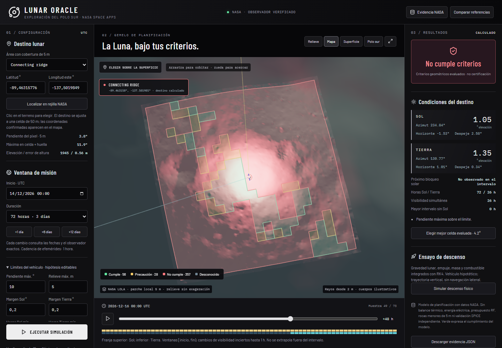

# LUNAR ORACLE · Lunar Landing Site Navigator

Cockpit 3D para estudiar destinos del polo sur lunar con **topografía NASA LOLA, efemérides NASA/JPL Horizons y descenso vertical calculado**. Entrada directa, sin cuenta ChatGPT ni clave NASA.

## Ejecutar

En Windows, desde la raíz del repositorio:

~~~powershell
npm.cmd --prefix frontend ci
python -m venv api/.venv
api/.venv/Scripts/python.exe -m pip install -r api/requirements.txt
npm.cmd run dev:full
~~~

Web: http://127.0.0.1:5173/ · API y documentación: http://127.0.0.1:8000/docs

Node 22.12+ y Python 3.11+. En Linux/macOS, usar npm, python3 y api/.venv/bin/python. El lanzador inicia los dos servicios y los detiene al cerrarse. Los derivados NASA y las consultas originales del caso inicial están incluidos; los grandes TIFF se descargan sólo para regenerar o auditar los derivados.

## Usar el cockpit

1. Selecciona **Connecting ridge** o **Shackleton rim**. También puedes elegir sobre el mapa o introducir coordenadas. El destino se ajusta a la rejilla analizada de 50 m y muestra sus coordenadas confirmadas.
2. Define inicio **UTC**, duración y criterios: pendiente, relieve, márgenes sobre el horizonte, horas mínimas de Sol y Tierra.
3. Pulsa **Ejecutar simulación**. Se consultan secuencialmente el Sol y la Tierra para ese observador exacto, con altura de 2 m. Si falta NASA, terreno o cobertura no se emite una evaluación.
4. Aparecen contornos sobre el DEM de detalle: **verde** cumple los criterios y reservas del modelo; **amarillo** cumple con poco margen o incertidumbre elevada; **rojo** incumple algún criterio; **gris** significa desconocido. La falta de datos nunca equivale a pendiente cero.
5. Desliza el tiempo. El mapa y las variables usan la misma muestra horaria. La vista **Polo sur** permite ver el contexto y los nombres geográficos NASA; **Mapa**, **Relieve** y **Superficie** acercan el destino.
6. **Simular descenso físico** reproduce una trayectoria vertical con gravedad lunar, empuje, masa y combustible variables. La animación usa los estados del integrador. El contacto queda marcado en las coordenadas elegidas, con velocidad y resultado.
7. **Evidencia NASA** muestra las consultas y productos del destino actual. **Descargar evidencia JSON** guarda la información necesaria para reproducir la evaluación.
8. **Comparar referencias** abre las herramientas científicas anteriores para los dos píxeles del catálogo. Es una comparación de referencias; la evidencia del punto elegido se consulta en el cockpit. Al volver se conserva el caso.

Cambiar parámetros invalida los contornos y la exportación hasta simular de nuevo. Seleccionar otra celda exige una nueva consulta NASA exacta; el botón de mejor celda es una búsqueda determinista dentro de la rejilla evaluada, no una respuesta inventada por IA.

El ejemplo inicial usa **14–17 de diciembre de 2026**, 2 m y paso de 60 minutos. Cuenta con respuestas JPL originales incluidas. Otros intervalos o celdas necesitan conexión JPL o una entrada de caché que coincida con todos los parámetros. Horizons no requiere una clave de api.nasa.gov.

## Datos y cálculo

| Parte | Fuente y alcance |
| --- | --- |
| Elevación, pendiente y error de altura | GeoTIFF originales NASA LOLA/PGDA [producto 78](https://pgda.gsfc.nasa.gov/products/78), espaciado de 5 m |
| Cobertura de aptitud | Dos áreas de 1,05 × 1,05 km; 441 celdas por área; el resto no tiene evaluación local preparada |
| Huella | Radio fijo de 15 m; el máximo de pendiente considera todos los píxeles de 5 m de cada celda más ese margen |
| Relieve | Rango de alturas en un cuadrado central de 35 × 35 m |
| Horizonte | 360 azimuts, esfera lunar sin exageración, norte/este local verdadero; rayos locales cada 10 m y regionales cada 250 m, hasta 250 km |
| Coherencia científica | Misma convención de horizonte que el motor anterior; pruebas comparan ambos en los píxeles de referencia |
| Sol y Tierra | [NASA/JPL Horizons](https://ssd-api.jpl.nasa.gov/doc/horizons.html), observador coord@301; azimut, elevación aparente sin refracción y distancia |
| Celdas vecinas | Traslación geométrica del vector aparente NASA con su distancia y conversión al ENU local; aproximación espacial declarada |
| Ventanas | Intervalos [inicio, fin); la muestra final no añade duración; incertidumbre temporal hasta una muestra |
| Nave | Hipótesis de ejemplo; RK4 con paso de 0,1 s, gravedad central JPL, caudal por Isp y límite de empuje |
| Vista 3D | Parche local de 5 m, contexto local de 75 m y contexto polar reducido; alturas sin exageración en el cockpit |

El contorno responde a pendiente, relieve, visibilidad instantánea y horas requeridas en todo el intervalo. La reserva amarilla de 0,5° angular y 1° de pendiente es una elección de cribado, **no una cota estadística de error**.

NASA indica que cerca del 90% de los píxeles de estos DEM de 5 m son interpolados: espaciado no equivale a resolución efectiva independiente. Se muestra el error de altura, pero aún no se propagan todas las incertidumbres. Los objetos menores de 5 m no quedan resueltos.

Es un **prototipo de gemelo de planificación**, con cobertura y modelos acotados. No es un sistema de navegación certificado. No calcula balance térmico, energía eléctrica, presupuesto de enlace RF, guiado lateral, estabilidad de patas ni trayectoria orbital Tierra–Luna. La validación independiente de marcos con SPICE sigue pendiente. Un contacto suave del vehículo hipotético no convierte una celda roja en apta.

## Verificar

~~~powershell
npm.cmd run build:hosted
api/.venv/Scripts/python.exe -m pytest api/tests -q
npm.cmd run test:science

# Servidor de producción local: frontend + API, sin Python
npm.cmd --prefix frontend run preview:hosted

# En otra terminal, con Google Chrome instalado
node frontend/scripts/verify-landing.mjs
node frontend/scripts/verify-planner.mjs
node frontend/scripts/verify-main-integration.mjs
~~~

Los tests científicos incluyen casos NASA almacenados, igualdad de perfiles entre motores, muestreo de TIFF nativos, curvatura, nodata, fechas inválidas, ventanas y dinámica física. El test de navegador cubre contornos, exportación, contacto, cambio de vistas, móvil y fallos de dependencias. Usa LUNAR_ORACLE_TEST_URL para cambiar la URL por defecto 4173.

## Regenerar los derivados NASA

~~~powershell
api/.venv/Scripts/python.exe api/scripts/acquire_nasa.py
api/.venv/Scripts/python.exe api/scripts/prepare_polar_atlas.py
api/.venv/Scripts/python.exe api/scripts/prepare_landing_surface.py
api/.venv/Scripts/python.exe api/scripts/prepare_landing_ephemeris.py
~~~

Los TIFF originales se guardan en data/raw, ignorado por Git. landing_surface.json conserva los SHA-256 de las siete fuentes originales, criterios de muestreo y limitaciones. Las consultas preparadas conservan parámetros completos, URL, fecha de recuperación y respuesta textual original JPL. Las peticiones JPL de preparación se ejecutan en serie.

## Dónde continuar

- frontend/src/features/tactical: cockpit, geometría, clasificación, contornos y navegación.
- frontend/src/features/mission: contexto, comparación de referencias e integrador de descenso.
- api/app/landing.py y frontend/worker/landing.mjs: adaptadores Python y alojado; reutilizan el cliente/parser de Horizons y las ventanas científicas.
- data/prepared/landing_surface.json: rejillas, DEM de detalle y perfiles.
- docs/science/landing_cockpit.md: metodología, correcciones y límites de esta integración.
- docs/science/mission_planner.md: motor anterior y física vertical.
- docs/research: investigación de mejoras y plan de IA fundamentada.

Antes de añadir IA conviene propagar incertidumbres y ampliar cobertura. Un asistente deberá citar resultados de estas herramientas y declarar datos desconocidos; no generar pendientes, efemérides o garantías de aterrizaje.

El repositorio y la aplicación local incluyen esta revisión. El sitio público existente conserva su último despliegue: el conector devuelve **Sites project not found** al solicitar escritura. No se ha publicado esta revisión allí ni se ha cambiado su acceso.
