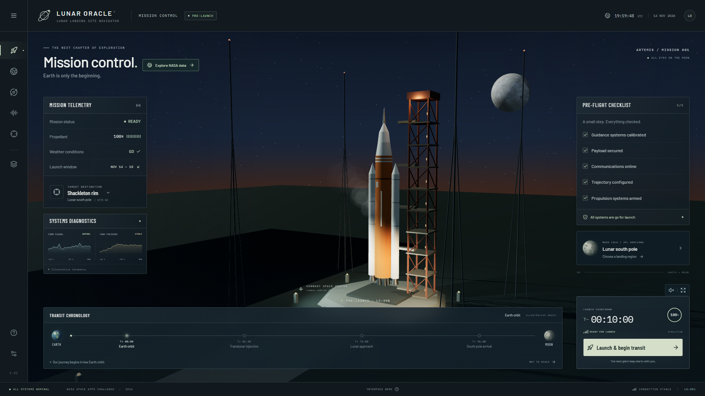

# LUNAR ORACLE · Lunar Landing Site Navigator

Exploración del polo sur lunar con **datos reales NASA LOLA y efemérides NASA/JPL Horizons**, acompañada de una misión 3D interactiva. Interfaz en inglés; documentación de desarrollo en español.

[Abrir el sistema](https://lunar-oracle-mission-control.gptcompartir.chatgpt.site) · [Metodología científica](docs/science/solar.md) · [Cobertura del Plan A](docs/IMPLEMENTATION_STATUS.md)

La web es pública: abre directamente en Mission Control, sin iniciar sesión en ChatGPT. El acceso se comprobó en un contexto de navegador sin cookies ni sesión. Mantener el acceso público al actualizar el despliegue de Sites.

El repositorio contiene el frontend, backend Python, adaptador para publicación, datos derivados reproducibles y pruebas. No se necesita una clave NASA para usar Horizons.



## Qué funciona

- **Mission Control 3D:** cohete y plataforma construidos con geometría, ignición, ascenso, viaje Tierra–Luna, descenso y aterrizaje. La región seleccionada determina el destino y su malla usa el DEM NASA preparado. Tierra y Luna tienen texturas oficiales con procedencia en [ASSET_CREDITS.md](frontend/src/components/scene/ASSET_CREDITS.md).
- **Lunar Explorer:** mapa polar 2D, selección de Connecting ridge / Site01 y Shackleton rim / Site04, coordenadas transformadas desde sus GeoTIFF, cobertura, elevación, pendiente e incertidumbre de altura.
- **Solar Observatory:** azimut, elevación y horizonte; inspección UTC, ventanas, horas visibles y mayor período sin visibilidad.
- **Earth Visibility:** consulta real de la Tierra desde la superficie lunar y sus ventanas geométricas.
- **Compare Sites:** ambos sitios con las mismas fechas, altura, muestreo y modelo de horizonte; diferencias explicadas sin puntuación de seguridad opaca.
- **Escenarios:** retrasos de fecha, alturas de observador y horizonte plano o de terreno disparan consultas/cálculos con los nuevos parámetros, no simples cambios de etiquetas.
- **Scientific Evidence:** inventario de siete productos, estado de adquisición, URLs, procedencia, supuestos y limitaciones. Exportación CSV de muestras.
- **Calidad:** estados de carga/error, cancelación de consultas obsoletas, caché exacta de resultados reales, UTC explícito, responsive y preferencia de movimiento reducido.

La trayectoria y el tiempo del viaje 3D son **cinematográficos**, no una solución de dinámica orbital. El combustible, clima y checklist de lanzamiento son demostraciones visuales. Las curvas científicas proceden de Horizons y los perfiles del terreno de LOLA; no se rellenan errores con números inventados.

## Ejecución local completa · Windows

Requisitos: Git, Node.js 22.12+ (comprobado con 24.14), Python 3.11 y, para las pruebas de navegador, Google Chrome.

```powershell
git clone https://github.com/GabrielChambi/NASA_MISION_ARTEMISA.git
cd NASA_MISION_ARTEMISA
npm.cmd --prefix frontend ci
python -m venv api/.venv
api/.venv/Scripts/python.exe -m pip install -r api/requirements.txt
npm.cmd run dev:full
```

Web: **http://127.0.0.1:5173/**. API: **http://127.0.0.1:8000/**. Documentación interactiva: **http://127.0.0.1:8000/docs**. `dev:full` inicia ambos servicios y los detiene al cerrar la sesión. Si un puerto ya está ocupado, cerrar el proceso anterior antes de iniciarlo.

En Linux/macOS usar `npm`, `python3` y `api/.venv/bin/python` en los comandos equivalentes; el lanzador detecta la plataforma.

Para iniciar por separado:

```powershell
# Terminal 1, desde la raíz
api/.venv/Scripts/python.exe -m uvicorn api.app.main:app --host 127.0.0.1 --port 8000
# Terminal 2, desde la raíz
npm.cmd run dev
```

Vite dirige `/api` al backend local. La fecha predeterminada (1–8 diciembre 2026, paso 60 minutos, altura 1 m) dispone de respuestas **reales precalculadas** para ambos cuerpos y sitios. Otras fechas, pasos o alturas requieren conexión a JPL o una entrada exacta en caché. `retrieved_at`, `cache_hit` y la URL original identifican su procedencia.

## Validación y compilación

```powershell
npm.cmd run build
api/.venv/Scripts/python.exe -m pytest api/tests -q
npm.cmd run test:science

# Con los dos servidores locales activos
node frontend/scripts/verify-home.mjs
node frontend/scripts/verify-science.mjs
```

Las pruebas Python cubren catálogo, UTC, parser JPL, ventanas semiabiertas, igualdad con el horizonte, nodata, interpolación circular y fallos explícitos. Las pruebas del adaptador contrastan muestras y métricas contra los resultados Python/NASA. La comprobación de interfaz cubre selección, curvas Sol/Tierra, comparación, horizonte, errores 503, reintento y móvil. `artifacts/` conserva capturas locales y queda fuera de Git.

Las seis consultas independientes de contraste JPL y su tolerancia están registradas en `data/prepared/validation.json`. Es validación contra la salida de JPL, no contra un segundo motor astrodinámico.

## Publicación y vista previa sin Python

```powershell
npm.cmd run build:hosted
npm.cmd --prefix frontend run preview:hosted
```

Abrir **http://127.0.0.1:4173/**. Este paquete sirve frontend y API mediante un Worker ESM. Lleva las mismas derivaciones NASA y respuestas previas; consulta Horizons para parámetros nuevos, con timeout, validación y errores explícitos. `frontend/scripts/build-hosted.mjs` incorpora los activos locales y los datos científicos en `frontend/dist/server/index.js`. La configuración de Sites mantiene la identidad existente y no contiene secretos.

`npm.cmd run preview` sirve la compilación estática con proxy a la API Python; requiere que el backend esté activo. El modo publicado no depende de una API Python alojada en este ordenador.

## Datos y reproducibilidad

```powershell
# Preparar de nuevo los siete productos NASA y perfiles
api/.venv/Scripts/python.exe api/scripts/acquire_nasa.py
# Consultas reales, caché y contrastes JPL
api/.venv/Scripts/python.exe api/scripts/prepare_ephemeris.py
```

Los originales grandes se guardan en `data/raw/` y no se suben a Git. El repositorio sí incluye catálogo, inventario, vistas 65×65, horizontes de 360 azimuts a alturas 1/2/5 m y las respuestas JPL originales usadas por la demostración. El primer reprocesado completo descarga varios cientos de MB. No requiere descargar todos los clones de incertidumbre de NASA.

Fuentes: [LOLA regiones](https://pgda.gsfc.nasa.gov/products/78), [GeoTIFF 5 m](https://pgda.gsfc.nasa.gov/data/LOLA_5mpp/), [DEM regional 80 m](https://pgda.gsfc.nasa.gov/data/LOLA_20mpp/LDEM_80S_80MPP_ADJ.TIF), [Horizons API](https://ssd-api.jpl.nasa.gov/doc/horizons.html), [manual Horizons](https://ssd.jpl.nasa.gov/horizons/manual.html), [SPICE](https://naif.jpl.nasa.gov/naif/).

## Arquitectura y puntos de entrada

```text
frontend/
  src/App.tsx                      # Mission Control y montaje
  src/components/LaunchScene3D.tsx  # Secuencia 3D
  src/features/mission/            # Contexto y navegación científica
  src/features/sites/              # Explorador polar
  src/features/solar/              # Curvas y cliente de API Sol/Tierra
  worker/science.mjs               # Adaptador publicado, con pruebas de paridad
  scripts/                         # Build y verificaciones
api/
  app/main.py                      # FastAPI
  app/core/                        # Catálogo y horizonte compartido
  app/solar/                       # Horizons, ventanas y servicio común
  scripts/                         # Adquisición NASA y preparación
  tests/
data/catalog/                      # Sitios e inventario con procedencia
data/prepared/                     # Datos derivados y respuestas NASA
docs/science/solar.md               # Método y límites implementados
scripts/dev-full.mjs                # Arranque conjunto
```

Campos compartidos: `siteIds`, `startUtc`, `endUtc`, `stepMinutes`, `horizonMode`, `delayHours`. Se añade `observerHeightM`. No renombrarlos en integraciones posteriores.

## API implementada

| Método y ruta | Resultado |
| --- | --- |
| `GET /api/health` | Disponibilidad y datos preparados |
| `GET /api/sites` | Sitios, coordenadas, medidas y procedencia |
| `GET /api/solar` | Efemérides y ventanas del Sol |
| `GET /api/earth` | Efemérides y ventanas de la Tierra |
| `GET /api/sites/{site_id}/terrain` | Malla reducida de alturas reales |
| `GET /api/terrain?site_id=...` | Alias de terreno |
| `GET /api/horizon` | Perfil preparado por sitio/altura |
| `GET /api/datasets` | Inventario de los siete productos |
| `GET /api/methodology` | Método, fuentes y límites |

Ejemplo: `/api/solar?site_id=site04&start_utc=2026-12-01T00:00:00Z&end_utc=2026-12-08T00:00:00Z&step_minutes=60&horizon_mode=terrain&observer_height_m=1`.

Las respuestas científicas incluyen `status`, `meta`, `samples`, `windows` y `summary`. Parámetros inválidos devuelven 422; fallo de JPL o datos ausentes, 503. Nunca se emite una curva ficticia como resultado válido. La comparación y los retrasos reutilizan estos servicios con parámetros idénticos o desplazados, respectivamente.

## Límites y siguientes pasos

- Los marcadores son píxeles de referencia regionales dentro del DEM, **no puntos de aterrizaje aprobados por NASA**. Cambiar a coordenadas arbitrarias exige volver a calcular cobertura, elevación y horizonte; todavía no se admite ese flujo.
- El horizonte de terreno sigue siendo **parcial**: búsqueda finita, muestreo radial y posibles obstáculos subpíxel. No certifica seguridad, energía eléctrica ni un enlace RF.
- Los productos de pendiente e incertidumbre se conservan como medidas de fuente; no se ha propagado esa incertidumbre hasta bandas probabilísticas del horizonte.
- La convención lunar mean-Earth está documentada; falta validación independiente con SPICE. Las ventanas son muestreadas, con incertidumbre de transición de hasta un paso.
- La revisión de una PR del integrante B y la presentación final requieren coordinación del equipo; no se inventa evidencia de esa colaboración.

Continuar con validación SPICE, selección de puntos dentro del DEM, propagación de incertidumbre y revisión cruzada. [El plan inicial](docs/DEVELOPMENT_PLAN.md) se conserva como contexto; el estado comprobado actual está en [IMPLEMENTATION_STATUS.md](docs/IMPLEMENTATION_STATUS.md).

Se utilizó IA como asistencia de programación. El fondo generado de la primera versión se conserva como activo histórico, pero **ya no se usa como escena inicial**. Elegir una licencia propia del proyecto antes de presentarlo como software de código abierto; las fuentes y dependencias conservan sus condiciones correspondientes.
