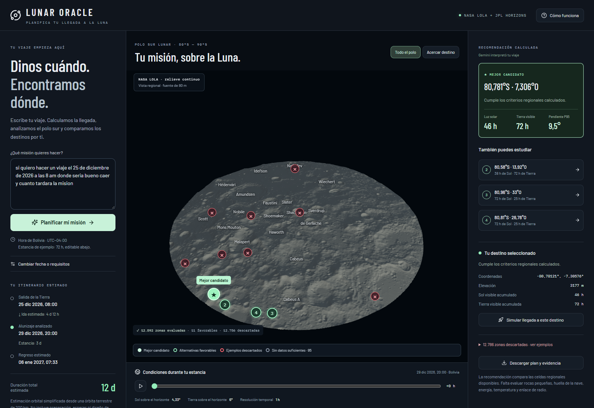
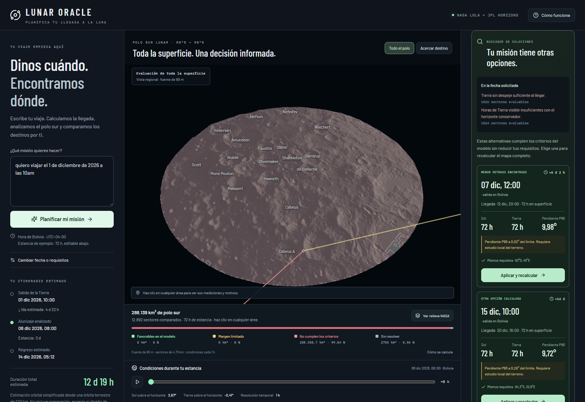

# LUNAR ORACLE · Lunar Landing Site Navigator

Escribe cuándo quieres viajar y el sistema calcula una **clasificación continua de toda la superficie del polo sur lunar, de 80°S a 90°S**. Una sola pantalla reúne la pregunta, el mapa 3D, los destinos, las condiciones durante la estancia y la duración estimada. Los visitantes entran directamente, sin iniciar sesión con ChatGPT ni Google.

> Quiero hacer un viaje el 25 de diciembre de 2026 a las 8 am. ¿Dónde sería mejor alunizar y cuánto tardaría la misión?

**Gemini interpreta la solicitud; el motor científico calcula con NASA LOLA y JPL Horizons.** Es un prototipo de planificación regional con hipótesis visibles, no un gemelo digital certificado ni una autorización de vuelo.

## Estado de la validación científica

El sistema es un modelo de planificación con NASA LOLA y JPL, **no un gemelo digital operacional validado**. Si faltan rasters o efemérides exactas, el estudio operativo informa la indisponibilidad: no sustituye el caso por una demostración. Los vehículos usan parámetros hipotéticos. El estudio físico calcula rutas nativas con regreso y presupuesto; los discos del visor siguen siendo referencias geométricas y ninguna ruta certifica seguridad.

La [auditoría científica](docs/SCIENTIFIC_AUDIT.md) registra defectos corregidos, contrastes directos con JPL, pruebas de conservación y modelos físicos aún pendientes. Pasar pruebas no demuestra ausencia total de errores ni seguridad de vuelo.

## Estudio físico ampliado

El resumen incorpora temperatura y radio. El estudio automático acopla calefacción, energía, curva térmica de batería y contactos con estaciones DSN. Contrasta efemérides con SPICE, calcula rutas de rover con regreso y permite importar perfiles y telemetría trazable. Las trayectorias de ida y vuelta se resuelven bajo condiciones de diseño explícitas.

Adquiere los kernels una vez con **api/.venv/Scripts/python.exe api/scripts/acquire_spice.py**, además de los rasters NASA. Consulta [ecuaciones, uso y límites](docs/ENGINEERING_MODELS.md). Los equipos y curvas de ejemplo no se atribuyen a una nave real. No hay conexión física autenticada ni validación operacional.

## English-speaking reviewers

Select **English** in the header. You can plan and revise a mission in English, inspect the whole south pole, and read the energy, terrain and visibility results in the same language. For example: “I want to travel on December 25, 2026 at 8am and stay 72 hours.” The default clock is Kennedy Space Center, America/New_York. Language changes preserve all calculated data.

[English workflow, the Earth-visibility correction, scientific scope and reproduction](docs/ENGLISH_AND_VISIBILITY.md).

## Conversación que ejecuta y conserva el contexto

Reconoce también «QUIERO HACER UN VIAJE EL 1DE DICIEMBREDE 2026 A LAS 10AM»: con Kennedy son las **15:00 UTC**. Después puedes pedir «retrasa 12 horas», «batería de mil Wh», «paneles un 20 % menos» o «corte de comunicaciones de 6 horas desde la hora 12». Se ejecuta el cálculo correspondiente conservando los demás parámetros. Si falta una unidad o el año, pregunta sólo por ese dato y acepta una respuesta breve.

El resumen principal separa evaluación de todo el polo, energía y huella local; las mediciones técnicas se despliegan. La conversación y las decisiones quedan en la evidencia descargable. Consulta [control conversacional, ejemplos y validación](docs/CONVERSATIONAL_MISSION_CONTROL.md).

## Cómo se usa

1. Escribe fecha y hora y pulsa **Planificar mi misión**, o prueba el ejemplo. El origen predeterminado es **Kennedy LC-39B**, con hora de Florida (`America/New_York`) y horario de verano; también puedes trabajar en UTC.
2. El sistema interpreta salida o alunizaje, estima el tránsito y compara automáticamente **12.892 zonas** de todo el casquete. No necesitas abrir otro estudio ni elegir capas.
3. La **capa de evaluación cubre todo el casquete visible** con colores y contornos verdes, amarillos, rojos y grises sobre el relieve NASA. No se limita a unos puntos. Los marcadores destacan centros recomendados, pero no sustituyen el campo completo de resultados.
4. Haz clic en **cualquier sector de la superficie**, aunque no tenga marcador, o introduce coordenadas en el inspector. Se muestran su clase, pendiente P95 y máxima, área, cobertura y razones. Cuando dispone de horizonte válido, el sistema obtiene su serie temporal propia; no copia la del mejor candidato. Reproduce **Condiciones durante tu estancia** para ver los cambios del Sol y la Tierra.
5. Cambia fecha, estancia y requisitos en **Preferencias del viaje** y recalcula. Los resultados anteriores se invalidan; los requisitos explícitos no se reducen para hacerlos encajar. **Descargar plan y evidencia** guarda el resultado completo, supuestos y consultas NASA. La animación de descenso usa una nave hipotética y no certifica el terreno.

La vista **Relieve** conserva el terreno gris sin confundir elevación con aptitud. En la vista **Evaluación**, los colores representan resultados del modelo:

| Clase | Interpretación regional |
| --- | --- |
| Verde | Cumple los requisitos incluso al variar entre los horizontes angulares muestreados |
| Amarillo | Resultado sensible a ese muestreo; requiere refinar el estudio |
| Rojo | Incumple el umbral regional P95 o los requisitos de visibilidad del escenario evaluado |
| Gris | Datos insuficientes, incluido el borde sin centro de evaluación preparado |

El algoritmo conserva la diferencia entre un **centro regional evaluado** y cada metro del sector. No declara toda una celda apta para apoyar la nave. Un P95 bajo el umbral puede coexistir con pendientes máximas mayores; ambas cifras se muestran.

## Ejecutar

Requiere Node 22.12+ y Python 3.11+. En Windows, desde la raíz:

~~~powershell
npm.cmd --prefix frontend ci
python -m venv api/.venv
api/.venv/Scripts/python.exe -m pip install -r api/requirements.txt
npm.cmd run dev:full
~~~

Abre [la aplicación local](http://127.0.0.1:5173/). La documentación FastAPI está en [127.0.0.1:8000/docs](http://127.0.0.1:8000/docs). El lanzador inicia ambos servicios, carga `.env` y los detiene al cerrarse. En Linux/macOS usa `npm`, `python3` y `api/.venv/bin/python`.

Los derivados NASA y las consultas originales del ejemplo están incluidos. Los TIFF grandes son necesarios para el nuevo estudio operativo local de huella y alturas. Descárgalos una vez con `api/.venv/Scripts/python.exe api/scripts/acquire_nasa.py`. El mapa regional puede utilizar sus derivados sin esos TIFF.

### Configurar Gemini

Gemini interpreta la solicitud como datos estructurados; la interfaz encadena automáticamente la consulta NASA y el análisis de destinos. No se queda en una respuesta de texto.

Obtén una clave del proyecto en [Google AI Studio](https://aistudio.google.com/apikey). Si todavía no tienes `.env`, copia `.env.example`; si ya existe, edítalo sin reemplazar sus valores privados:

~~~dotenv
AI_PROVIDER=gemini
AI_MODEL=gemini-3.5-flash-lite
GEMINI_API_KEY=tu_clave
~~~

El modelo es configurable según disponibilidad y permisos del proyecto Google. Reinicia el servidor después de editar la configuración.

~~~powershell
npm.cmd run ai:check
npm.cmd run ai:check -- --generate
~~~

La clave sólo se usa en el servidor. No la pongas en variables `VITE_`, en el navegador ni en Git. El despliegue remoto necesita su propio secreto `GEMINI_API_KEY`; el archivo `.env` local no se publica. Los visitantes no necesitan claves ni cuentas.

Si Gemini falla o falta la clave, un intérprete determinista reconoce fechas y requisitos compatibles y se identifica como sistema. No se presenta como IA. Si falta la fecha, pide ese dato. Si omites la hora, usa las 08:00 en la zona indicada como hipótesis visible y editable.

### Compilar y previsualizar la versión alojable

~~~powershell
npm.cmd run build:hosted
npm.cmd --prefix frontend run preview:hosted
~~~

Abre [la vista previa](http://127.0.0.1:4173/). Incluye frontend y API Worker y funciona sin un proceso Python. También lee `.env`.

## Caso reproducible y alcance científico

El caso de [automatic_example.json](data/prepared/automatic_example.json) usa salida el **25 de diciembre de 2026 a las 08:00 de Bolivia**, estancia de 72 h, pendiente regional máxima de 10° y mínimos de 12 h de Sol y Tierra visible.

| Resultado del modelo | Valor |
| --- | --- |
| Salida UTC | 25 dic 2026 · 12:00 |
| Tránsito ideal de ida | 107,56 h; ajuste de llegada de +26,11 min hasta la siguiente hora |
| Llegada analizada | 30 dic 2026 · 00:00 UTC |
| Estancia | 72 h |
| Regreso estimado | 6 ene 2027 · 11:33:53 UTC |
| Duración total estimada | 287,56 h, aproximadamente 12 días |
| Clasificación regional | 9 verdes, 2 amarillas, 12.786 rojas y 95 centros desconocidos |
| Mejor candidato | −80,78120657°, −7,30575953°; `polar:5:56` |
| Visibilidad del mejor candidato | 46 h de Sol y 72 h de Tierra |

Estos valores dependen de la fecha, los requisitos y los derivados. El tránsito es una transferencia elíptica ideal de dos cuerpos desde una órbita terrestre de 200 km; el regreso usa la misma duración ideal. No se ha diseñado una trayectoria Artemis ni una ventana real de lanzamiento.

El [DEM regional NASA LOLA de 80 m](https://pgda.gsfc.nasa.gov/data/LOLA_20mpp/LDEM_80S_80MPP_ADJ.TIF) se agrega en sectores de 4,75 km. Cada zona tiene su **propio** horizonte con muestras cada 5°; no se reutiliza el de un punto para toda la Luna. El motor requiere alcance válido de al menos 20 km por dirección muestreada y conserva la cobertura distante como parcial, incluso con rayos hasta 250 km.

El cálculo de área usa el jacobiano inverso de la proyección estereográfica sobre la esfera lunar, con cuadratura y recorte al límite de 80°S. El casquete teórico tiene **288.138,649 km²**; los cuadrados con centros preparados representan **287.392,894 km²**. Los **745,754 km² restantes** se conservan como borde desconocido y se suman al área gris. Los 95 centros desconocidos son un recuento distinto de esa franja: no se incrementa artificialmente el número de centros a 12.892 más el borde.

La clase amarilla utiliza mínimos y máximos de los dos azimuts vecinos del horizonte y el intervalo de cuantización de 0,05°. Es un **escenario de sensibilidad**, no una probabilidad ni una cota completa del error físico. Pueden quedar obstáculos entre rayos y errores del DEM sin resolver.

Las posiciones y distancias del Sol y la Tierra provienen de [NASA/JPL Horizons](https://ssd-api.jpl.nasa.gov/doc/horizons.html). Se trasladan geométricamente desde un observador lunar de referencia a cada zona, con cadencia horaria. El modelo regional no resuelve rocas pequeñas, huella, energía, temperatura ni presupuesto de radio. La validación independiente completa de marcos con SPICE sigue pendiente.

La metodología y los endpoints están en [Misión automática](docs/AUTOMATIC_MISSION.md). El [estudio de superficie completa](docs/SOUTH_POLE_SURFACE_ANALYSIS.md) documenta proyección, cobertura, sensibilidad y fuentes primarias de NASA.

## Verificar y reproducir

Con la aplicación local iniciada mediante `npm.cmd run dev:full`:

~~~powershell
npm.cmd run test:science
api/.venv/Scripts/python.exe -m pytest api/tests -q
$env:LUNAR_ORACLE_TEST_URL='http://127.0.0.1:5173/'
node frontend/scripts/test-surface-coverage.mjs
node frontend/scripts/validate-surface-parity.mjs
node frontend/scripts/test-automatic-mission.mjs
node frontend/scripts/test-live-plan.mjs
node frontend/scripts/test-mission-conversation.mjs
~~~

Las pruebas de navegador requieren Google Chrome. Comprueban la superficie completa, selección fuera de los marcadores, coordenadas, clases, áreas, fuentes NASA, cambios temporales, errores y móvil. El respaldo determinista es válido cuando se identifica como tal; para exigir que la interpretación se haya realizado mediante Gemini, usa `LUNAR_ORACLE_REQUIRE_AI=1`.

`test-live-plan.mjs` consulta una fecha distinta de los ejemplos preparados, el 26 de diciembre de 2026, y exige tres consultas trazables. La caché es opcional: los fallos de acceso, lectura o escritura no bloquean una consulta nueva a JPL.

Las suites Node y Python incluyen sensibilidad angular, conservación del área y el endpoint de una celda. Ambos motores producen el mismo resultado en las 12.892 celdas. Las pruebas unitarias del proveedor usan respuestas controladas y cubren sus fallos; las comprobaciones de navegador pueden usar la configuración privada real del servidor.

Para verificar también la compilación Worker en una vista previa local independiente:

~~~powershell
npm.cmd run build:hosted
npm.cmd --prefix frontend run preview:hosted
~~~

La vista previa escucha en `http://127.0.0.1:4173/`; configura `LUNAR_ORACLE_TEST_URL` con esa dirección para probarla. El trabajo actual se concentra en ejecución local.

Para reproducir el ejemplo y la comparación independiente con consultas directas a JPL en tres puntos:

~~~powershell
api/.venv/Scripts/python.exe api/scripts/prepare_automatic_example.py
api/.venv/Scripts/python.exe api/scripts/validate_global_reference.py
~~~

El [informe de tres puntos](docs/validation/global-reference-validation.json) compara tres horas por astro y punto para una fecha. Su alcance no valida cada ubicación, el terreno ni la viabilidad de una misión real.

Para regenerar el conjunto regional:

~~~powershell
api/.venv/Scripts/python.exe api/scripts/acquire_nasa.py
api/.venv/Scripts/python.exe api/scripts/prepare_polar_atlas.py
api/.venv/Scripts/python.exe api/scripts/prepare_polar_screening.py
api/.venv/Scripts/python.exe api/scripts/prepare_global_horizons.py
api/.venv/Scripts/python.exe api/scripts/prepare_lunar_detail.py
~~~

Los TIFF se guardan en `data/raw`, ignorado por Git. Los derivados registran fuente y SHA-256; las consultas JPL conservan parámetros, URL, fecha de recuperación y respuesta original.

## Dónde continuar

- [UnifiedMissionPlanner.tsx](frontend/src/features/mission/UnifiedMissionPlanner.tsx): experiencia única de usuario.
- [mission_intent.py](api/app/mission_intent.py) y [mission-intent.mjs](frontend/worker/mission-intent.mjs): extracción validada de la solicitud.
- [automatic_plan.py](api/app/automatic_plan.py) y [automatic-plan.mjs](frontend/worker/automatic-plan.mjs): planificación automática Python y Worker.
- [prepare_global_horizons.py](api/scripts/prepare_global_horizons.py): perfiles propios desde el DEM nativo.
- [AUTOMATIC_MISSION.md](docs/AUTOMATIC_MISSION.md): metodología, evidencia y limitaciones.
- [SOUTH_POLE_SURFACE_ANALYSIS.md](docs/SOUTH_POLE_SURFACE_ANALYSIS.md): estudio de cobertura espacial y criterio científico.

Las APIs científicas anteriores se conservan para compatibilidad y auditoría. El recorrido principal utiliza la interfaz unificada y no envía al visitante a pantallas antiguas.

La [verificación de paridad](docs/validation/surface-parity.json) compara las 12.892 celdas y diez campos entre Python y JavaScript usando las mismas tres respuestas originales de NASA, sin conexión. Comprueba consistencia de implementaciones y cierre de áreas; no es una certificación independiente de seguridad.

## Cuando la fecha solicitada no cumple: alternativas calculadas

El sistema ya no se limita a mostrar un mapa rojo. Si no hay candidatos verdes, inicia automáticamente una búsqueda acotada de otras fechas, conservando estancia, pendiente máxima, mínimos de Sol/Tierra y altura del observador. Compara hasta 15 fechas diarias de los siguientes 14 días y refina hasta 23 inicios horarios antes del primer día evaluado que cumple: como máximo 38 escenarios. El resultado es el primer inicio que cumple **entre los examinados**, no un óptimo continuo global.

El panel explica los bloqueos de la fecha original y ofrece hasta tres propuestas calculadas. **Aplicar y recalcular** cambia la fecha de forma explícita, vuelve a evaluar las 12.892 zonas y actualiza el texto del viaje. El texto y los parámetros originales quedan guardados en la comparación y en el JSON exportado. Los datos desconocidos no se convierten en alternativas y un fallo de NASA no genera propuestas inventadas.

Caso reproducible: «quiero viajar el 1 de diciembre de 2026 a las 10am», hora de Bolivia, estancia de 72 h, pendiente regional máxima 10° y mínimos de 12 h de Sol y Tierra. La fecha original no tiene candidatos verdes. Entre las fechas examinadas, la propuesta con menor retraso es **7 dic 2026, 12:00 Bolivia**, 146 h después; llegada estimada **12 dic, 20:00 Bolivia**. Recalcular todo el casquete confirma el sector polar:32:95, con 72 h de Sol y Tierra en el modelo. Su P95 de 9,9843° está cerca del límite de 10°: la interfaz muestra esa limitación y exige estudio local; no certifica una huella de aterrizaje.

El bloque **¿Cuánto margen queda?** muestra la próxima pérdida o recuperación del despeje del Sol y de la Tierra en el sector seleccionado, con intervalos horarios e identificación del fin de datos. Puede verse la lista de ventanas individuales y simultáneas. No extrapola ni convierte visibilidad en energía eléctrica o enlace RF garantizado.

~~~powershell
node frontend/scripts/test-mission-rescue.mjs
~~~

Las seis respuestas originales NASA de la búsqueda y de la aplicación exacta se identifican en data/prepared/rescue_example.json. Las suites Node y Python validan ese caso sin red. El detalle del algoritmo y la evolución propuesta hacia un gemelo ambiental y operacional están en [DECISION_SUPPORT_AND_TWIN_ROADMAP.md](docs/DECISION_SUPPORT_AND_TWIN_ROADMAP.md).

## Perfiles de vehículo sin supuestos ocultos

El chat acepta perfiles `.json` o metadatos `.gltf` de hasta 1 MiB, con parámetros numéricos obligatorios. Los objetos del catálogo son ejemplos hipotéticos; no representan especificaciones verificadas del fabricante. La referencia regional utiliza paneles y antena a 2 m, que es la altura de los horizontes preparados. Otras alturas quedan como datos desconocidos hasta calcular horizontes propios. La tolerancia de un perfil nunca amplía el límite de pendiente elegido por el usuario.

La explicación de Gemini se apoya en las mediciones y las fuentes del escenario; no afirma supervivencia, producción eléctrica o prestaciones de radio a partir de visibilidad geométrica. Para comprobar importaciones inválidas, límites conservados, perfiles sin cobertura y selección accesible en escritorio/móvil:

~~~powershell
node frontend/scripts/test-vehicle-profile-integrity.mjs
~~~

## Energía, fallos y estudio local

En **Estudio de misión**, la misma página calcula generación solar con distancias JPL cada 15 minutos, estado de batería, reserva, cargas suspendidas, memoria y transmisión con tasa declarada. El ejemplo de nave es hipotético y editable; no se atribuyen sus parámetros a NASA. Un presupuesto fallido activa propuestas que comparan sitio, fecha y horarios, conservando las horas científicas y los criterios.

El destino local permite introducir coordenadas exactas, estudiar una elipse de dispersión con la huella circular de la nave y recalcular horizontes para las alturas declaradas de panel y antena. Los datos5m sólo se usan dentro de Site01/Site04; el resto mantiene80m y las huellas pequeñas quedan sin resolver. La evaluación detallada no cambia de color toda una celda regional.

El centro de lanzamiento y el reloj se incluyen en la exportación, junto con los presupuestos, configuración, fuentes y propuesta aplicada. La elección de Kennedy no convierte la estimación orbital en un ascenso o una ventana de lanzamiento real.

[Ver el estudio de la elipse sobre terreno nativo de5m](docs/images/mission-operations-native.png).

Consulta [metodología, fuentes, instalación de rasters y reproducción](docs/MISSION_OPERATIONS.md). Esta extensión nativa se ejecuta con la API Python local; el Worker conserva sus servicios anteriores y no ejecuta este cálculo de rasters.

~~~powershell
node frontend/scripts/test-mission-operations.mjs
api/.venv/Scripts/python.exe api/scripts/validate_operations_observer.py
~~~
