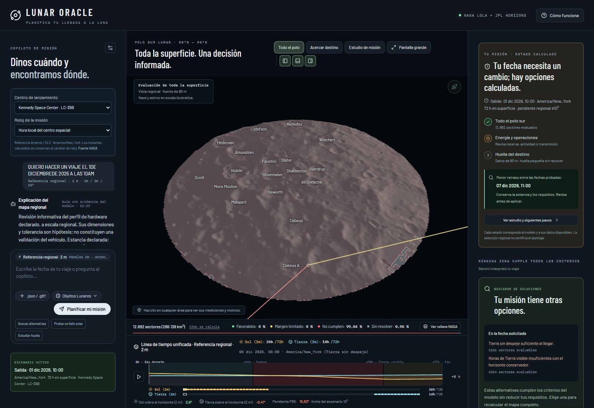

# Control conversacional de misión

La conversación ejecuta cambios verificables sobre el escenario activo. Una fecha completa no debe provocar una pregunta redundante, y un cambio de batería no debe borrar la fecha, los requisitos ni los fallos ya declarados.

## Caso que motivó la corrección

Entrada literal: **QUIERO HACER UN VIAJE EL 1DE DICIEMBREDE 2026 A LAS 10AM**.

Con el reloj predeterminado de Kennedy (America/New_York), el resultado es **1 de diciembre de 2026, 10:00; 15:00 UTC**. El intérprete separa las palabras pegadas y conserva día, mes, año y hora. No transforma una fecha imposible en otra válida.

El sistema compara los 12.892 centros del casquete 80–90°S. Para los requisitos de ejemplo de 72 h de estancia, pendiente regional máxima de 10° y mínimos de 12 h de Sol y Tierra, esa fecha no tiene candidato verde. Se inicia la búsqueda científica acotada de otras fechas sin reducir requisitos. La primera propuesta sólo sustituye el escenario cuando el usuario la aplica explícitamente.

## Peticiones encadenadas

| Petición | Acción |
| --- | --- |
| «Aplica la primera alternativa» | Aplica una propuesta existente y vuelve a calcular; no inventa una fecha |
| «Retrasa la salida 12 horas» | Suma 12 h al instante activo, conserva criterios y vuelve a consultar el motor |
| «Cambia la hora a las 10 am» | Conserva el día según el reloj activo |
| «Cambia la fecha al 1 de diciembre a las 10 am» | Conserva el año activo y declara esa suposición |
| «Quiero estar 48 horas» | Actualiza estancia y formulario; conserva los límites no mencionados |
| «Batería de mil Wh» | Estudia 1000 Wh con la configuración restante conservada |
| «¿Qué pasa si mis paneles producen un 20 % menos?» | Introduce una pérdida solar de 0,20 y calcula un nuevo presupuesto |
| «Corte de comunicaciones durante 6 horas desde la hora 12» | Introduce el corte desde +12 h después del alunizaje |
| «Busca alternativas» | Busca fechas si no existe candidato regional; en un escenario con candidato compara ajustes operativos |
| «Estudia la huella local del destino» | Abre el estudio nativo del destino actual |

Los experimentos de energía y terreno requieren la API Python local y los TIFF NASA indicados en [MISSION_OPERATIONS.md](MISSION_OPERATIONS.md). El Worker conserva su planificación regional; no ejecuta el estudio nativo ni el nuevo recurso semántico local.

Cuando falta un dato, se pregunta por ese dato. «Batería de 1000» solicita Wh o kWh; responder «Wh» completa la orden pendiente. Una misión sin año pide el año; «2026 a las 10 am» completa la solicitud anterior. Los valores fuera de rango, las comparaciones ambiguas o una estancia menor que los mínimos exigidos no se aplican silenciosamente.

Las preguntas explicativas y las órdenes negativas como «No cambies la batería de 1000 Wh» no modifican parámetros. El escenario activo permanece visible mientras se completa otra petición.

## Arquitectura y límites de la IA

1. Los normalizadores Python y JavaScript corrigen separaciones habituales, mayúsculas, meses conocidos y números escritos. Un corpus compartido verifica paridad.
2. El intérprete valida calendario, zona horaria, requisitos explícitos y rangos. Una petición inicial puede usar Gemini con salida estructurada; las fechas compatibles funcionan también sin proveedor.
3. El despachador conversacional resuelve acciones sobre el contexto actual y únicamente permite campos numéricos autorizados.
4. Si una orden no encaja, /api/copilot/command puede pedir a Gemini una reformulación estructurada. El servidor comprueba esquema, tamaño, cifras, cantidades con unidades y conservación de negaciones. La reformulación vuelve a pasar por el mismo despachador. El modelo no recibe acceso para ejecutar herramientas arbitrarias.
5. Los resultados físicos y operativos provienen de las APIs científicas, nunca de los números que redacte un modelo de lenguaje. Los errores del proveedor dejan una pregunta concreta y conservan el escenario.

El endpoint semántico no garantiza comprender cualquier frase. Una reformulación validada todavía requiere la validación de los parámetros y la ejecución científica. No se atribuyen a NASA las especificaciones hipotéticas del vehículo, el consumo ni las prestaciones de radio.

## Lugar fijado y condiciones temporales

Puedes fijar un lugar sobre el mapa antes de planificar. Su pin conserva la coordenada regional seleccionada y se usa como destino para estudiar cuando se calcula una fecha; el análisis sigue comparando todo el casquete. Las franjas del borde sin un centro evaluado se pueden inspeccionar y permanecen desconocidas; no se ajustan a un centro interior. Sin fecha ni resultados temporales, el copiloto pide una referencia y mantiene las condiciones como desconocidas. No recomienda una estación ni meses fijos por una coordenada. NASA muestra cómo cambian las sombras con la fecha y el relieve en [Shadows near the Moon’s South Pole](https://svs.gsfc.nasa.gov/4893/) y [Illumination to 80°S, 2025–2028](https://svs.gsfc.nasa.gov/5027/).

## Una decisión comprensible y auditable

El resumen principal separa tres estados:

- **Todo el polo sur:** clasificación regional por terreno y visibilidad.
- **Energía y operaciones:** batería, reserva, ciencia y presupuesto de datos para la configuración declarada.
- **Huella del destino:** cobertura nativa y evaluación de la elipse.

Un sector verde regional no implica presupuesto energético suficiente ni huella segura. Los datos de 80 m no resuelven una huella pequeña de la nave. Los estados pendientes permanecen explícitos.

Las mediciones detalladas del copiloto se pueden desplegar. El engranaje superior abre las preferencias; si un valor es incompatible, muestra el error y mantiene abierto el formulario para corregirlo. Escape permite cerrarlo. El JSON descargado conserva el historial reciente de conversación, fechas interpretadas, centro de lanzamiento, parámetros, fuentes, estudios y propuestas aplicadas. Ese registro permite revisar qué se pidió, qué se cambió y qué se calculó.

## Reproducir

Con npm.cmd run dev:full activo:

~~~powershell
npm.cmd run test:science
api/.venv/Scripts/python.exe -m pytest api/tests -q
$env:LUNAR_ORACLE_TEST_URL='http://127.0.0.1:5173/'
node frontend/scripts/test-mission-conversation.mjs
node frontend/scripts/test-automatic-mission.mjs
node frontend/scripts/test-mission-rescue.mjs
node frontend/scripts/test-mission-operations.mjs
~~~

El navegador usa la API y el motor reales, comprueba el texto literal de la captura, la búsqueda de fechas, experimentos encadenados, negación, aclaraciones, preferencias, exportación y móvil. Las pruebas unitarias verifican además respuestas controladas del proveedor, entradas imposibles y rechazo de cifras inventadas.

La [evidencia de esta comprobación local](validation/conversation-controls.json) registra el caso literal, las suites verificadas y el ensayo real de Gemini.
