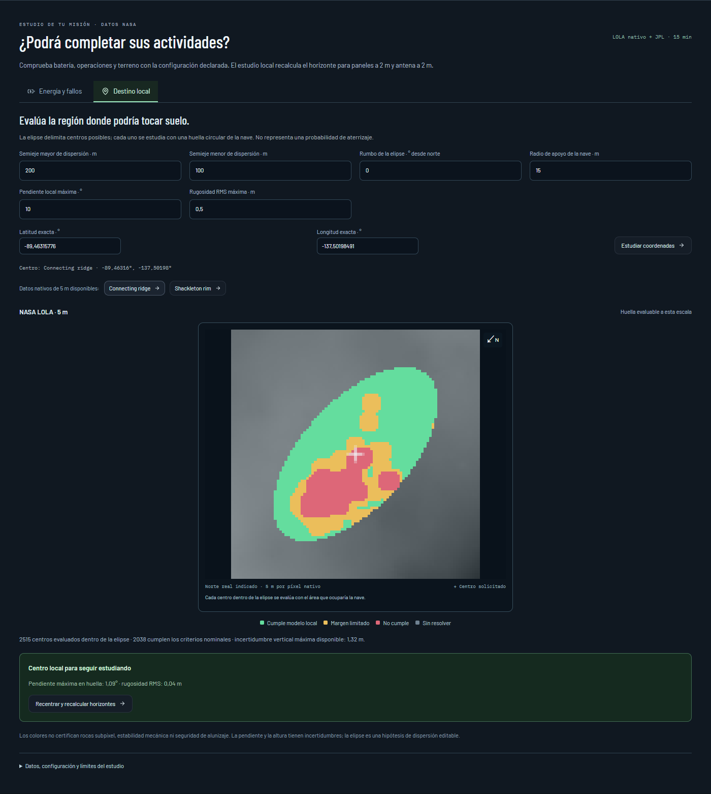

# Operaciones de misión: energía, fallos y terreno local

Implementación local del 15 de noviembre de 2026. Esta extensión utiliza la API Python y los rasters originales NASA conservados en `data/raw`. El mapa regional continúa evaluando los 12.892 centros del casquete; el estudio operativo añade presupuestos de una configuración declarada y una evaluación local de mayor detalle.

## Origen y tiempo

Kennedy Space Center, LC-39B, es el origen de referencia Artemis/SLS. Se ofrecen también LC-39A y Vandenberg SLC-4E como contextos de lanzamiento documentados. Elegir una instalación no afirma compatibilidad entre cualquier nave, plataforma y trayectoria lunar.

- [NASA LC-39B](https://www.nasa.gov/humans-in-space/exploration-ground-systems/launch-pad-39b/).
- [NASA Commercial Crew: LC-39A](https://www.nasa.gov/humans-in-space/commercial-space/commercial-crew-program/commercial-crew-program-overview/).
- [NASA SPHEREx/PUNCH: SLC-4E](https://svs.gsfc.nasa.gov/14803/).

El reloj usa `America/New_York` o `America/Los_Angeles`, con la base IANA y su horario de verano. El usuario puede elegir UTC. Un cambio de reloj conserva el instante ya calculado; la petición visible pasa a expresar ese instante explícitamente. Una hora inexistente o repetida durante una transición DST exige aclaración; no se elige un offset arbitrario.

Ejemplos: 1 dic 2026 10:00 en Kennedy equivale a 15:00 UTC; 1 jul 10:00 equivale a 14:00 UTC. En Windows se instala `tzdata` junto con las dependencias Python.

El lugar de lanzamiento es contexto explícito de la misión. El tránsito sigue siendo una estimación elíptica de dos cuerpos desde órbita terrestre de 200 km: no calcula ascenso desde la plataforma, meteorología, disponibilidad de lanzador, inserción, guiado ni una ventana de lanzamiento real. Una fecha futura introducida por el usuario no es un lanzamiento anunciado por NASA.

## Electricidad y actividades

Las posiciones y distancias proceden de JPL Horizons, con muestras exactas cada 15 minutos. Las consultas conservan parámetros, URL, fecha de recuperación y texto original. El observador polar de referencia se traslada geométricamente al centro local y a las alturas declaradas de panel y antena; la aproximación no sustituye una validación completa de marcos con SPICE.

La referencia solar es 1361 W/m² a 1 AU, escalada por el cuadrado inverso de la distancia. Es un valor de referencia, no telemetría solar futura. NASA documenta tanto esta magnitud como los efectos de orientación en la generación fotovoltaica: [irradiancia NASA GSFC](https://earth.gsfc.nasa.gov/climate/projects/solar-irradiance/science), [NASA Power Subsystems](https://www.nasa.gov/smallsat-institute/sst-soa/power-subsystems/).

~~~text
P_solar = 1361 × (AU/r_solar)² × área × eficiencia × factor_eléctrico
          × max(0, normal_panel · dirección_Sol) × despeje × fracción_no_ocultada

Carga:    ΔE = η_carga × P_entrada × Δt
Descarga: ΔE = −P_salida × Δt / η_descarga
~~~

La orientación puede ser fija, con inclinación desde la horizontal y azimut desde el norte verdadero, o seguimiento solar ideal declarado. No se deduce orientación a partir del nombre o aspecto de una nave. El despeje exige que el centro solar supere el horizonte muestreado en 0,3°. La ocultación por la Tierra se aproxima mediante intersección de discos angulares con los radios y distancias correspondientes al observador solar. No se modelan atmósfera terrestre, penumbra detallada del terreno, auto-sombra ni variaciones solares no observadas.

El ejemplo de hardware es hipotético y editable: área y eficiencia, capacidad y carga inicial de batería, reserva, eficiencias, potencias máximas, cargas esencial/opcional/ciencia/radio, duración de ciencia, producción de datos, tasa de transmisión y memoria. No constituye una ficha NASA ni de fabricante. La carga esencial debe incluir los equipos críticos y la calefacción que el diseño requiera; no se resuelve la temperatura del vehículo.

El controlador prioriza carga esencial, ciencia, radio y carga opcional. Registra cargas no servidas y actividades suspendidas. Los cruces de agotamiento se resuelven dentro del intervalo de potencia constante; también se dividen intervalos cuando un fallo o actividad cambia dentro de ellos. Se separan reserva y agotamiento. El clamp de batería a cero no elimina el déficit registrado.

Se conservan energía almacenada, generación, consumo servido, excedente limitado, pérdidas de carga/descarga y residual del balance. Un residual pequeño comprueba la contabilidad numérica; no demuestra fidelidad física del hardware.

La memoria utiliza GB decimales y tasas configuradas en Mbit/s. Los datos se acumulan durante una obstrucción o fallo de comunicación y se transmiten cuando el modelo permite hacerlo. Una saturación registra pérdida permanente, aunque después vuelva el enlace. La tasa no procede de un presupuesto RF: requiere antenas, banda, apuntamiento, estación y capacidades de misión verificadas para ese uso.

Cada muestra representa el intervalo hasta la siguiente. La muestra final no añade duración. Los huecos geométricos no se sustituyen por generación cero y una batería ficticia: el presupuesto pasa a estado desconocido. La cadencia de 15 minutos puede omitir eventos más breves.

## Replanificación ante fallos

Se pueden introducir retraso de la fecha solicitada, pérdida de producción solar desde una hora y corte de comunicaciones con inicio/duración. Son escenarios del usuario, no fallos observados de una misión real. El retraso mueve salida o llegada según el significado de la petición y genera consultas NASA para las nuevas fechas.

Ante un presupuesto que falla, la interfaz inicia una búsqueda acotada. Examina hasta cuatro centros disponibles del plan y tres fechas, con desplazamientos 0, +24 y +48 horas desde el escenario afectado. Para cada centro/fecha compara el horario actual, una redistribución de las mismas horas de ciencia y esa redistribución suspendiendo la carga declarada opcional. El máximo es 36 combinaciones; puede detenerse tras obtener suficientes propuestas.

La redistribución es una heurística que prioriza potencia disponible y se verifica posteriormente mediante el presupuesto completo. No es un optimizador global. No se reducen las horas científicas ni se amplían los límites de pendiente o visibilidad. Una suspensión opcional se declara de forma explícita. Los requisitos de Tierra se comprueban descontando el corte introducido, además del balance de datos.

Las propuestas muestran sitio, fecha, política, reserva mínima, ciencia completada y consecuencias. Aplicar una recalcula el mapa completo y el estudio operativo; la propuesta original y su evidencia se conservan en la exportación. Que una alternativa cumpla electricidad/datos y filtros de planificación no demuestra que su elipse de dispersión sea apta: la huella se estudia por separado.

Un resultado sin solución significa que ninguna combinación examinada pasó. Una pérdida completa de producción o comunicaciones puede requerir cambiar el diseño o los objetivos, en lugar de forzar un destino verde.

## Huella y dispersión sobre el terreno nativo

Los rasters se verifican contra SHA-256 de los productos adquiridos. Los únicos datos de 5 m disponibles son Site01 y Site04, con sus productos de elevación, pendiente e incertidumbre vertical. Fuera de sus coberturas se conserva el raster regional de 80 m; nunca se presenta un remuestreo visual como resolución científica de 5 m.

Fuente y advertencias del producto: [NASA PGDA78](https://pgda.gsfc.nasa.gov/products/78). Muchos píxeles de 5 m son interpolados: la separación de píxeles no representa precisión o resolución de observaciones independientes.

El usuario declara semiejes y rumbo de una elipse de dispersión, radio de apoyo circular, pendiente local y rugosidad toleradas. La elipse no lleva una distribución de errores validada, por lo que su área favorable no es una probabilidad de éxito.

Se evalúan todos los centros nativos dentro de la elipse, considerando los píxeles que intersectan su huella circular. Se utiliza un margen geométrico por extensión de píxel. Para cada huella se calcula máxima pendiente nativa, altura incierta disponible y rugosidad RMS tras retirar el plano ajustado. El rumbo se refiere al norte verdadero; el mapa indica su dirección, que no coincide siempre con el norte de la cuadrícula polar.

- Verde: pasa los criterios locales nominales declarados.
- Amarillo: pasa nominalmente con margen reducido; ese margen no es una cota estadística de incertidumbre.
- Rojo: incumple una condición que los datos disponibles pueden evaluar.
- Gris: falta información o la escala no resuelve la huella.

Un centro con huella resuelta a 5 m utiliza ese criterio local en lugar del P95 de un sector de 4,75 km. Esto permite estudiar un lugar local favorable dentro de un sector regional exigente. El mapa de todo el polo conserva su clasificación regional; no se pinta todo el sector de verde a partir de una huella.

Una huella de diámetro 30 m no se declara resuelta con datos de 80 m. Tampoco un pase con datos de 5 m descarta rocas subpíxel, valida patas/centro de gravedad o propaga toda la incertidumbre. Se informa la incertidumbre vertical y se conservan esas limitaciones.

El estudio recalcula perfiles esféricos propios a cada altura: 1° de azimut, muestras radiales de 5 m hasta 2 km, 80 m hasta 20 km y 250 m hasta 250 km, siempre conservando la resolución real del raster utilizado. Se requiere cobertura cercana completa y alcance mínimo de 20 km por dirección. La cobertura distante es parcial y se informa; no se rellena terreno ausente con una esfera ni con horizonte plano.

## Ejecutar y reproducir

~~~powershell
api/.venv/Scripts/python.exe -m pip install -r api/requirements.txt
api/.venv/Scripts/python.exe api/scripts/acquire_nasa.py
npm.cmd run dev:full
~~~

Los TIFF originales están ignorados por Git y se descargan una vez. Son necesarios para este módulo local. Los derivados ya preparados siguen permitiendo utilizar el mapa regional sin ellos. La versión Worker mantiene los servicios anteriores; esta extensión nativa requiere la API Python y no está implementada como cálculo de rasters en el Worker.

Endpoints POST, con JSON limitado a 32 KiB:

- `/api/operations/analyze`: misión, centro regional, energía, fallo, política y elipse; acepta una coordenada local exacta, que se asocia a su centro regional real.
- `/api/operations/replan`: el mismo contrato con hasta cuatro candidatos; devuelve propuestas y escenarios efectivamente examinados.

Caso offline: [operations_example.json](../data/prepared/operations_example.json) identifica las tres respuestas NASA originales y el presupuesto esperado. El instante es explícitamente 25 dic 12:00 UTC, equivalente a 07:00 en Kennedy; no se reinterpreta como las 08:00 del nuevo ejemplo de la interfaz.

~~~powershell
api/.venv/Scripts/python.exe -m pytest api/tests/test_operations_energy.py api/tests/test_operations_terrain.py -q
node --test frontend/worker/timezones.test.mjs
node frontend/scripts/test-mission-operations.mjs
api/.venv/Scripts/python.exe api/scripts/validate_operations_observer.py
~~~

El [contraste guardado con observadores JPL directos](validation/operations-observer-validation.json) comprueba cinco épocas separadas por15 minutos para cada astro en un punto, con panel a50m y antena a38m. El máximo error angular observado fue aproximadamente 0,000002074°. La tolerancia previa fue 0,001°. Esa muestra verifica la traslación del observador frente a consultas JPL del propio punto; no es validación completa independiente de marcos con SPICE, del terreno o de una nave.

## Preguntas del copiloto

El chat conserva el historial y recibe un resumen separado del mapa regional y del presupuesto operativo actual. La respuesta numérica se contrasta con los hechos recibidos y sus redondeos; cifras nuevas o conclusiones no respaldadas activan una guía determinista identificada como tal. Un contexto ausente no se sustituye por24 sectores verdes o4 candidatos. El cuerpo y el historial están limitados. La explicación no ejecuta cambios del plan. La validación de texto reduce errores, pero no es validación física independiente ni prueba formal de toda la semántica de una respuesta generada.
